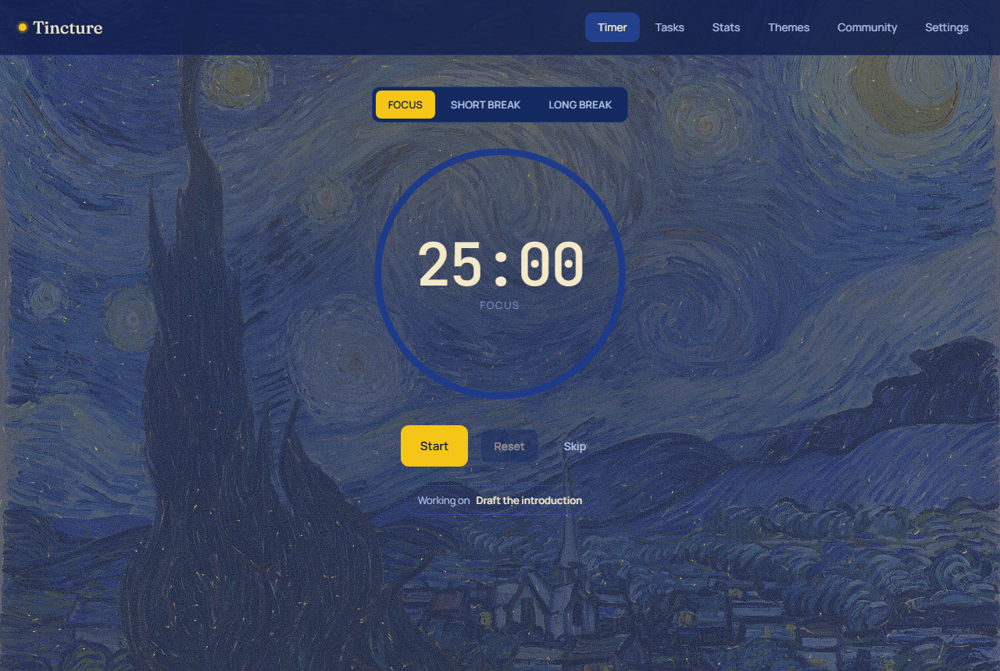
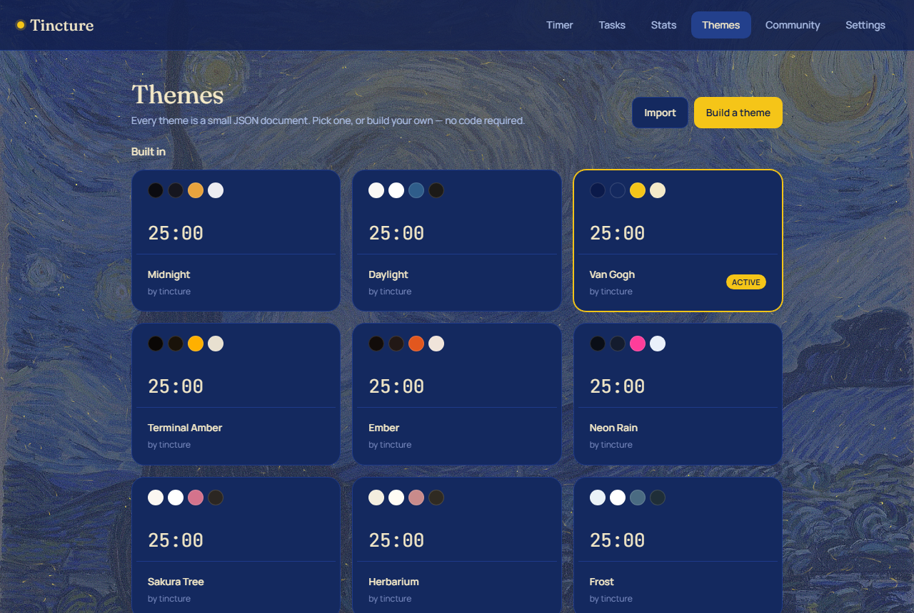
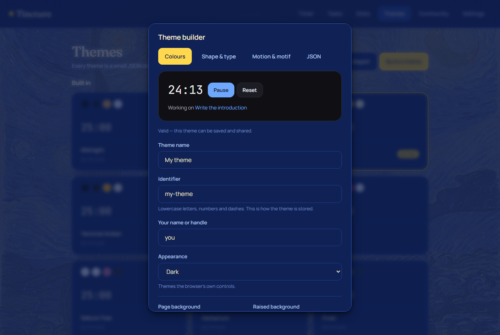

# Tincture

A Pomodoro focus timer with a **community theme system**.

Themes are the product here; the timer is the excuse for them. A theme is a small JSON
document of typed tokens — never CSS — so a theme written by a stranger can change how the
app looks without being able to reach the network, run code, or read anything.



## Why a theme is not CSS

Most theme systems accept a stylesheet, then try to clean it. That is a losing position:
`url()` is an outbound request, `@font-face` is a fetch, and a `background-image` on a large
surface is a fingerprint. Sanitising CSS means enumerating every way CSS can reach out.

Tincture inverts it. There is no code path that accepts a CSS string from a theme:

- A theme names **tokens** (`color.accent`, `dimension.radiusMd`, `shadow.card`) from a closed
  list. Unknown keys are rejected.
- Values are **typed**: colours are hex only, dimensions are a number plus a unit from a fixed
  set, font families come from a bundled whitelist, shadows are structured objects of numbers.
- The app converts tokens into CSS custom properties **itself**.

A hex string cannot contain a parenthesis, so the entire function-injection class is
unreachable — not filtered out, unreachable. The full argument, including what is *not*
covered, is in [`docs/SECURITY.md`](docs/SECURITY.md).

## Features

- **Timer** — focus, short break, long break, with a long break every fourth session. Pause,
  reset, skip. Space toggles. The countdown is derived from an anchor timestamp rather than
  incremented, so a throttled background tab, a suspended laptop, or a reload cannot make it
  drift.
- **Tasks** — give a job an estimate in pomodoros; each finished focus session fills a pip.
- **Statistics** — today, current streak, and the last fourteen days.
- **Themes** — nine built in: two neutrals (Midnight, Daylight) and seven character themes,
  each with its own background **motif**. Plus a visual builder that needs no code, and
  import/export as JSON.
- **Ambience** — the character themes are not recolours. Each names a motif from a closed
  enum and the app paints it: *Starry Night* advected by its own brushwork, a hearth whose
  glow follows the timer phase, rain mirrored in a wet street, a seeded L-system tree,
  crystals growing in from the window frame, a drafting grid, a specimen plate. A theme
  chooses; the app owns the bytes and the renderer.
- **Community** — themes other people contributed, read straight from this repository over the
  GitHub API. No backend, and every submission is a reviewable commit.
- **Offline by default.** Everything lives in `localStorage`. No account, no server, nothing
  sent anywhere. The community gallery is the only feature that needs a network, and it says
  so when it is unavailable.



## Build a theme

**In the app.** Themes → *Build a theme*. Every edit is validated as you type, so the live
preview is showing you something the app would actually paint. *Copy JSON* gives you the
document to share.



**By hand.** Add one file to `themes/`. The filename must match the theme's `id` — the test
suite enforces it, so the gallery listing and the theme cannot disagree.

```json
{
  "id": "ember",
  "name": "Ember",
  "author": "you",
  "date": "2026-10-12",
  "version": "1.0.0",
  "license": "MIT",
  "appearance": "dark",
  "tokens": {
    "color": { "bg": "#141110", "accent": "#e2703a", "...": "every colour token" },
    "dimension": { "radiusMd": "10px", "...": "every dimension token" },
    "fontFamily": { "display": "instrument-serif", "body": "manrope", "mono": "jetbrains-mono" },
    "shadow": { "card": { "x": 0, "y": 1, "blur": 2, "spread": 0, "color": "#00000073" } }
  },
  "effects": { "grain": 0.07, "glow": 0.4, "motion": 0.9, "blur": 10 }
}
```

Themes are **complete, not partial**: every token must be defined, because a theme with holes
would inherit the previous theme's values and look broken in ways nobody could debug. Start
from `themes/moss.json` — the community folder — or from any file in
`src/theme/builtin/`.

Then open a pull request. CI validates it, and if something is wrong the message names the
token and the reason — not `Invalid input`.

## Commands

```bash
npm install
npm run dev       # dev server
npm run build     # tsc -b && vite build — must pass with zero errors
npm run lint      # oxlint
npm run test      # vitest — the theme validator, the timer maths, and the theme gate
npm run verify    # build + test: the gate before claiming anything works
npm run preview   # serve the production build
npm run check:browser   # the Playwright pass, against the preview server
```

## Architecture

```
src/
  theme/
    schema.ts      zod schemas — the single source of truth for what a theme may contain
    validate.ts    validation, alias resolution, human-readable errors
    apply.ts       validated tokens -> CSS custom properties
    builtin/       the nine shipped themes, as JSON
  app/
    timer/engine.ts   the timer as pure functions over an anchor timestamp
    state/            reducer, context, persistence
    views/            timer, tasks, stats, themes, gallery, onboarding, builder
  ui/                 primitives — every one token-driven
themes/               community submissions, one JSON file each
docs/SECURITY.md      the security model
```

Three constraints hold the whole thing together:

- **No state library.** One reducer and one context. The store is a few hundred lines; a
  dependency would add a failure surface without removing any of the thinking.
- **No router.** Six views behind one `view` field.
- **`localStorage` is untrusted.** It is user-writable, so it goes through the same validator
  as a downloaded theme. A store edited in DevTools is rejected on the same grounds as one
  fetched from GitHub.

## Stack

React 19 · Vite 8 · TypeScript 6 (strict) · zod, for the theme schema only · vitest · oxlint.
Static hosting on Vercel, with the CSP in `vercel.json` and again in `index.html`.

Adding a dependency requires a reason that survives the question *"what breaks without it?"*

## Licence

MIT.
