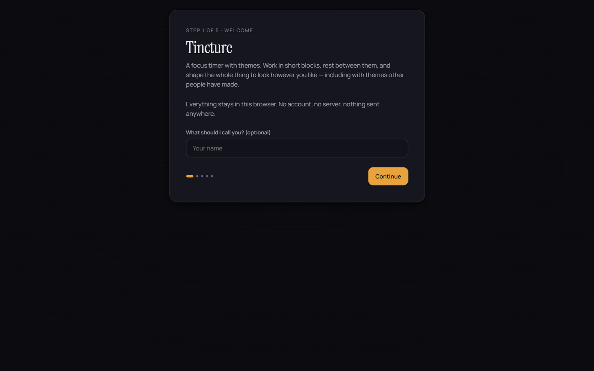
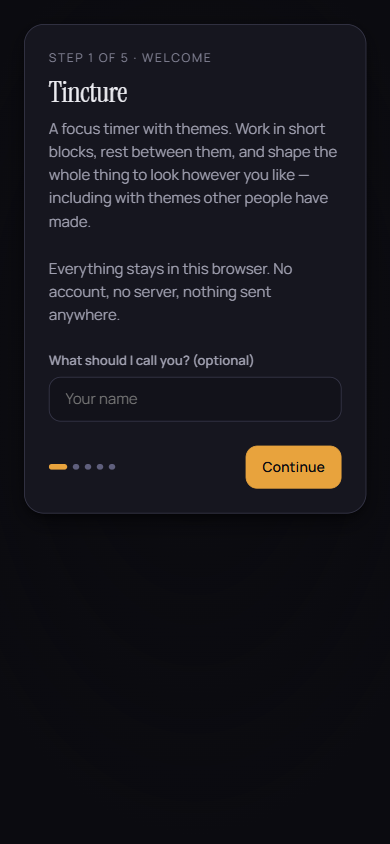

# Tincture

Pomodoro focus timer with a community theme system — themes are typed JSON tokens, never CSS.

**Live demo:** —

<div align="center">

| Desktop | Mobile |
|---|---|
|  |  |

</div>


<div align="center">

<details>
<summary>More screenshots — timer, builder, themes</summary>

<p>


</p>

</details>

</div>

## What it does

The timer is the excuse for the theme system. A theme is a small JSON document of typed tokens (`color.accent`, `dimension.radiusMd`, `shadow.card`) validated by zod — a theme from a stranger cannot reach the network, run code, or read anything, because no code path accepts a CSS string from a theme at all. The app converts validated tokens into CSS custom properties itself; the full argument, including what is *not* covered, is in [docs/SECURITY.md](docs/SECURITY.md).

Nine built-in themes ship, each character theme with its own painted background motif; community themes are read straight from the `themes/` folder of this repository over the GitHub API, so every submission is a reviewable commit.

## Tech stack

React 19 · Vite 8 · TypeScript (strict) · zod (theme schema only) · vitest · oxlint — hosted on Vercel.

## Features

- Countdown derived from an anchor timestamp, not incremented — a throttled tab, a suspended laptop or a reload cannot make it drift
- Theme validation is typed and closed-list: unknown keys rejected, hex-only colours, fixed unit set, bundled font whitelist
- `localStorage` treated as untrusted — it passes through the same validator as a downloaded theme
- Tasks with pomodoro estimates, 14-day statistics, long break every fourth session
- Theme builder in-app plus import/export as JSON; community gallery via GitHub API

## Run locally

```bash
npm install
npm run dev        # dev server
npm run build      # tsc -b && vite build
npm run test       # vitest — theme validator, timer maths, theme gate
npm run verify     # build + test
```

## What I learned

Sanitising CSS from untrusted themes is a losing position — `url()`, `@font-face` and `background-image` each hide an outbound request. Replacing the CSS input with a closed, typed token list makes the whole function-injection class unreachable instead of filtered.
